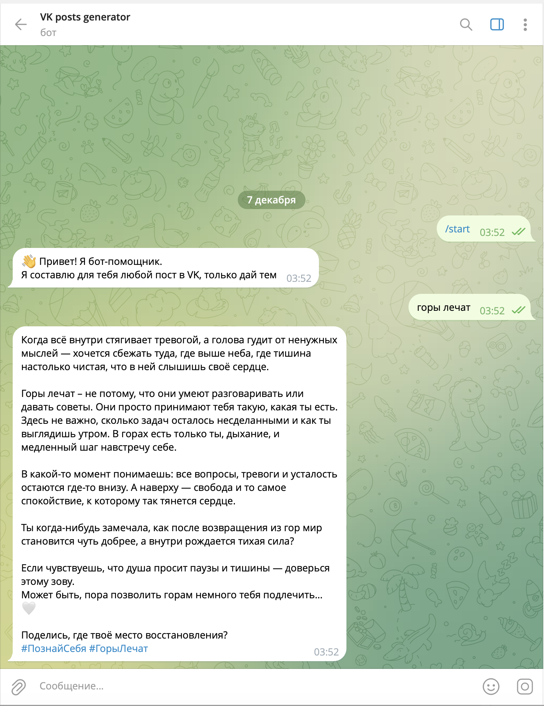
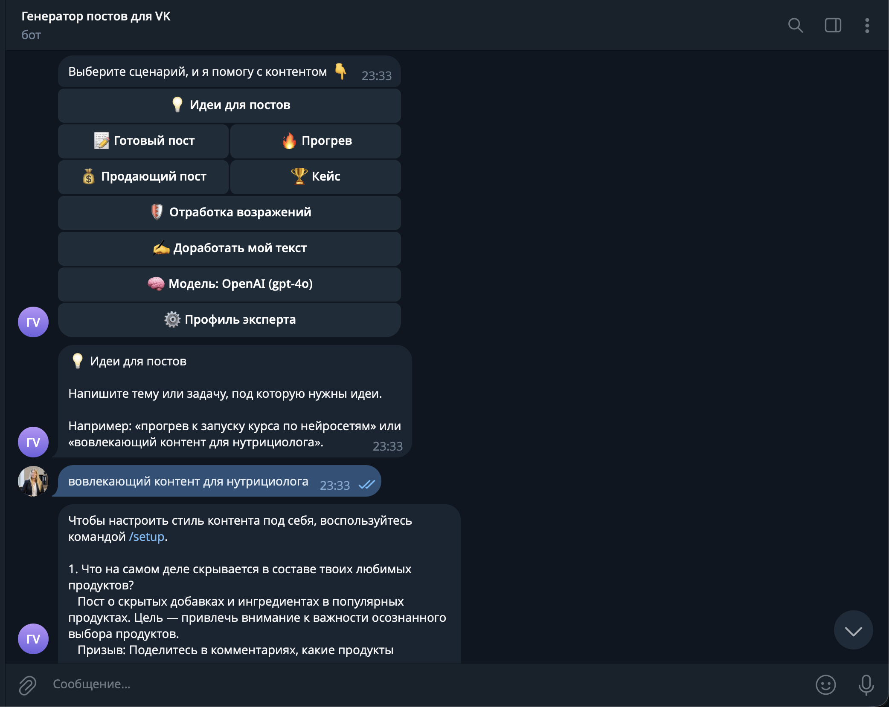
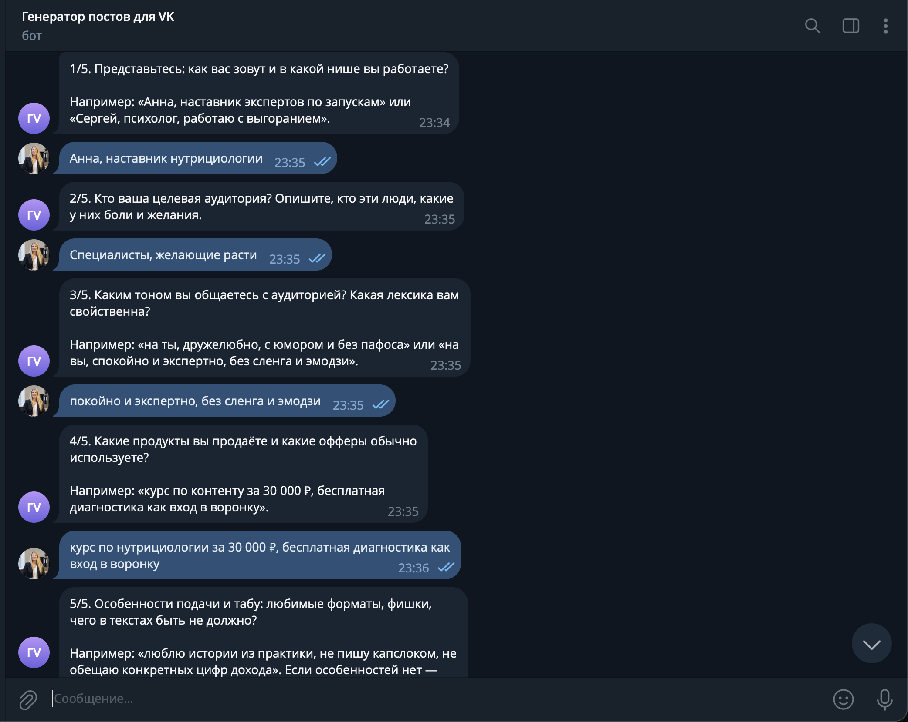
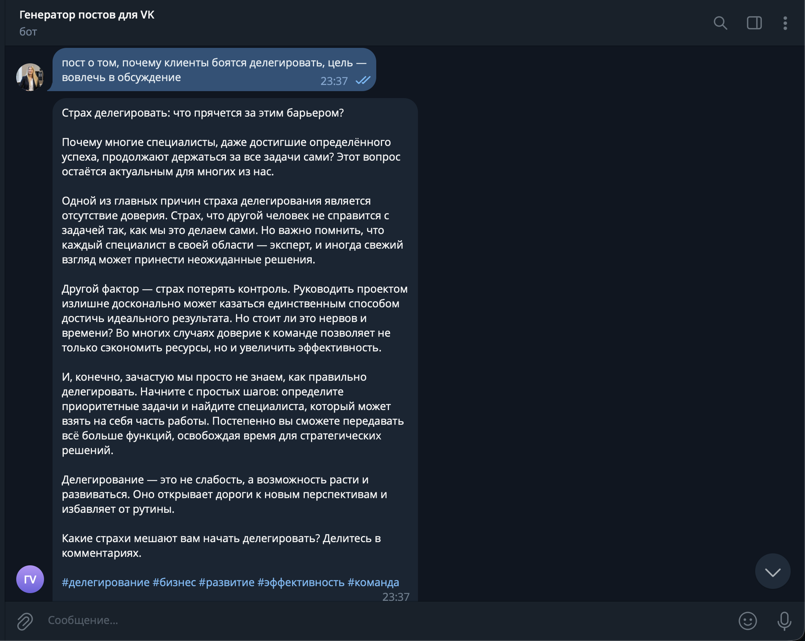
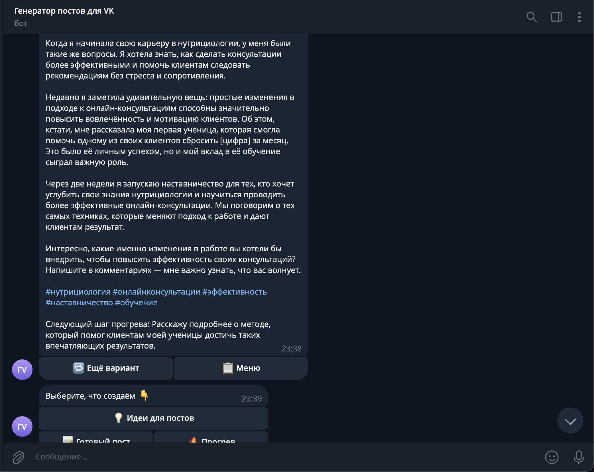
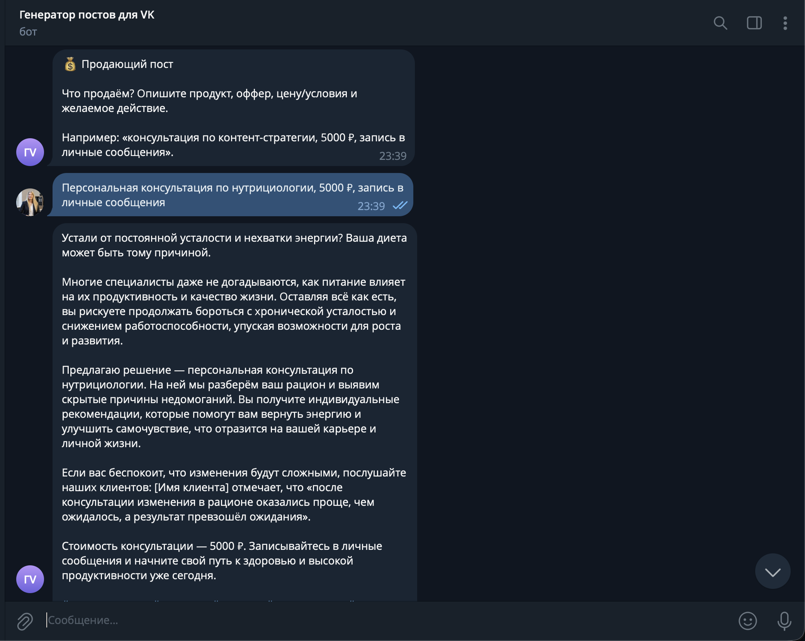

# SMM-бот для постов ВКонтакте в голосе эксперта

Telegram-бот помогает эксперту в инфобизнесе быстро писать контент для ВКонтакте: идеи, готовые посты, прогревы, продающие тексты, кейсы, ответы на возражения и доработку черновиков. Тексты звучат так, будто их написал сам эксперт.



## О проекте

Бот хранит профиль эксперта: нишу, аудиторию, тон, продукты и особенности подачи. Профиль подставляется в системный промпт при каждой генерации, поэтому стиль не нужно объяснять заново. Тип контента выбирается кнопкой, бот задает один уточняющий вопрос и присылает пост, оформленный под ВКонтакте.

Модель переключается кнопкой: OpenAI GPT-4o или GigaChat.

## Задача

Эксперт тратил больше 15 часов в неделю на посты для ВКонтакте. Контент становился однообразным, охваты падали, а копирайтер в этой нише не окупался. Работа с ChatGPT в браузере тоже не спасала: каждый раз приходилось заново описывать свой стиль, аудиторию и формат соцсети.

## Решение

1. **Профиль эксперта.** Команда `/setup` запускает анкету из пяти вопросов: имя и ниша, аудитория, тон и лексика, продукты и офферы, особенности подачи и табу. Профиль можно посмотреть командой `/profile`, перенастроить или сбросить.
2. **Семь сценариев.** Десять идей для постов с заголовками и призывом к действию. Готовый пост от заголовка до хештегов. Прогрев, который подводит к продаже без продажи в лоб. Продающий пост по классической структуре от боли к офферу. Кейс клиента по схеме «точка А, что делали, точка Б». Пост, который разбирает возражение вроде «дорого» или «не получится». Доработка черновика с объяснением, что и почему изменено.
3. **Оформление под ВКонтакте.** Без markdown, который ВК не показывает, короткие абзацы, умеренные эмодзи, призыв к действию и 3–6 хештегов. Если модель все же вставит разметку, бот вычистит ее перед отправкой.
4. **Две модели.** Кнопка «Модель» или команда `/model` переключает OpenAI и GigaChat. Обе работают через общий интерфейс, сценарии и профиль действуют одинаково.
5. **Правки в диалоге.** После генерации можно написать «сделай короче» или «замени призыв на запись в личку», или нажать «Еще вариант». Команда `/reset` очищает контекст.

## Как это выглядит

| Меню и идеи | Анкета эксперта | Готовый пост |
|:-:|:-:|:-:|
|  |  |  |
| **Прогрев** | **Продающий пост** | **Кейс** |
|  |  |  |

Остальные шаги (вторая часть идей, сохранение профиля, возражения и смена модели, просмотр профиля) лежат в `demo/`.

## Результат

- Время на пост сократилось с 40 до 2 минут.
- Охваты выросли на 30%.
- Заявок из соцсетей стало на 15% больше.

## Стек технологий

| Технология | Зачем используется |
|---|---|
| **Python** | Язык бота, в контейнере 3.12 |
| **python-telegram-bot** | Кнопки, диалоги, команды, анкета профиля |
| **OpenAI API** | Основная модель генерации, по умолчанию `gpt-4o` |
| **GigaChat API** | Вторая модель, по умолчанию `GigaChat-2-Max` |
| **python-dotenv** | Ключи в `.env`, вне кода |
| **Docker Compose** | Запуск бота на сервере, профили экспертов хранятся в `data/` |

## Структура репозитория

- `bot.py`: меню, сценарии, команды, кнопки и анкета профиля.
- `prompts.py`: системный промпт с правилами оформления под ВК и шаблоны семи сценариев.
- `profiles.py`: анкета, сохранение и чтение профилей в JSON.
- `llm.py`: общий интерфейс к OpenAI и GigaChat, очистка markdown.
- `config.py`: настройки из `.env`.
- `legacy/`: ранние версии проекта на Assistants API, LangChain и GigaChat.
- `INSTRUCTIONS.md`: инструкция для пользователя бота.
- `demo/`: скриншоты.

## Запуск

```bash
python3 -m venv .venv
.venv/bin/pip install -r requirements.txt
cp env-example .env
.venv/bin/python bot.py
```

В `.env` нужны `TELEGRAM_TOKEN` и `OPENAI_API_KEY`. `GIGACHAT_CREDENTIALS` нужен, только если хочется переключаться на GigaChat. Если ключа какого-то провайдера нет, бот скажет об этом при переключении.

В Docker: `docker compose up -d --build`.

Дальше в Telegram: `/start`, настройка профиля через `/setup` и выбор сценария в меню.

## Автор

Татьяна Дзюбас, AI-инженер по автоматизации. Делаю Telegram-ботов, RAG-ассистентов и LLM-агентов, которые снимают рутину с небольших команд. Кейсы и контакты на [tatidzufri.com](https://tatidzufri.com).
