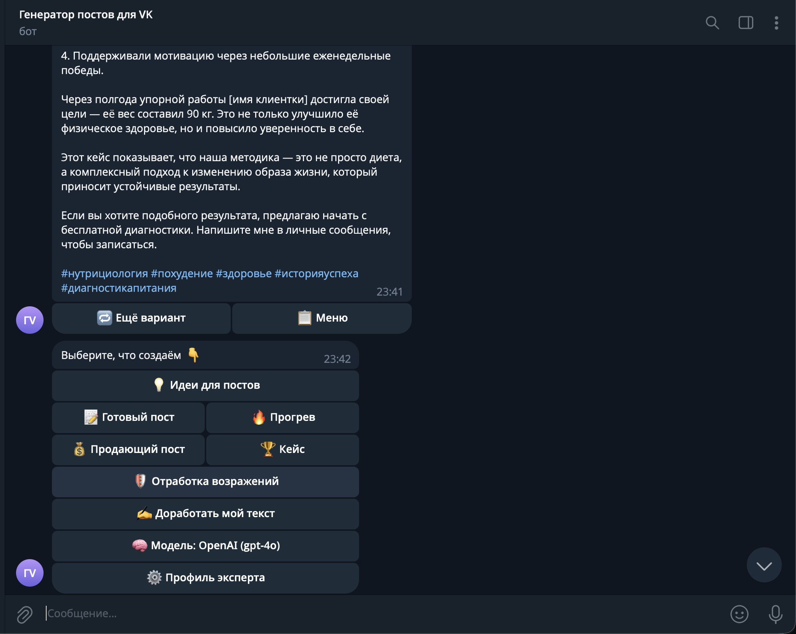

# VK Generator: a social media bot that writes in an expert's voice

A Telegram bot that helps an expert or coach write content for VKontakte (VK), Russia's largest social network: post ideas, finished posts, warm-up posts, sales posts, case stories, answers to objections and edits of drafts. The texts sound like the expert wrote them.

This is a practice project. Case study: [tatidzufri.com/en/case/vk-generator](https://tatidzufri.com/en/case/vk-generator). The bot speaks Russian.


## About the project

The bot keeps an expert profile: niche, audience, tone, products and style notes. The profile goes into the system prompt on every generation, so the style never has to be explained again. The content type is picked with a button, the bot asks one clarifying question and sends a post formatted for VK.

A button switches the model between OpenAI GPT-4o and GigaChat.

## The task

Experts who sell courses and consultations need a steady stream of posts, and writing them eats hours every week. Posts start to sound alike, and a copywriter rarely pays off in a small niche. ChatGPT in the browser doesn't solve it either: every time you have to describe your style, audience and the social network's format from scratch.

## How it works

1. **Expert profile.** `/setup` starts a five-question onboarding: name and niche, audience, tone and vocabulary, products and offers, style notes and taboos. `/profile` shows the profile, which can be redone or reset.
2. **Seven scenarios.** Ten post ideas with headlines and calls to action. A finished post from headline to hashtags. A warm-up that leads toward a sale without a hard pitch. A sales post with the classic structure from pain to offer. A client story built as "point A, what we did, point B". A post that takes on an objection such as "too expensive" or "it won't work for me". An edit of a draft with an explanation of what changed and why.
3. **Formatted for VK.** No markdown, which VK doesn't render; short paragraphs, a few emoji, a call to action and 3–6 hashtags. If the model slips markdown in anyway, the bot strips it before sending.
4. **Two models.** The "Model" button or `/model` switches between OpenAI and GigaChat. Both sit behind one interface, so scenarios and the profile work the same way.
5. **Edits in the chat.** After a post is generated you can write "make it shorter" or "change the call to action to a DM", or press "Another version". `/reset` clears the context.

## What it looks like

| Menu and ideas | Expert profile | Finished post |
|:-:|:-:|:-:|
|  |  |  |
| **Warm-up** | **Sales post** | **Client story** |
|  |  |  |

The other steps (the second half of the ideas, saving the profile, objections and switching models, viewing the profile) are in `demo/`.

## Results

- Seven content scenarios behind one menu, each using the saved expert profile.
- Two interchangeable models, OpenAI and GigaChat, with the same scenarios and profile.
- VK formatting is enforced in code, not just requested in the prompt.

## Tech stack

| Technology | What it's for |
|---|---|
| **Python** | Bot language, 3.12 in the container |
| **python-telegram-bot** | Buttons, dialogs, commands, profile onboarding |
| **OpenAI API** | Main generation model, `gpt-4o` by default |
| **GigaChat API** | Second model, `GigaChat-2-Max` by default |
| **python-dotenv** | Keys in `.env`, outside the code |
| **Docker Compose** | Runs the bot on the server; expert profiles are stored in `data/` |

## Repository structure

- `bot.py`: menu, scenarios, commands, buttons and the profile onboarding.
- `prompts.py`: the system prompt with VK formatting rules and the seven scenario templates.
- `profiles.py`: onboarding, saving and loading profiles as JSON.
- `llm.py`: one interface to OpenAI and GigaChat, markdown cleanup.
- `config.py`: settings from `.env`.
- `legacy/`: early versions on the Assistants API, LangChain and GigaChat.
- `INSTRUCTIONS.md`: a user guide for the bot (in Russian).
- `demo/`: screenshots.

## Running it

```bash
python3 -m venv .venv
.venv/bin/pip install -r requirements.txt
cp env-example .env
.venv/bin/python bot.py
```

`.env` needs `TELEGRAM_TOKEN` and `OPENAI_API_KEY`. `GIGACHAT_CREDENTIALS` is only needed if you want to switch to GigaChat. If a provider's key is missing, the bot says so when you switch.

With Docker: `docker compose up -d --build`.

Then in Telegram: `/start`, set up the profile with `/setup` and pick a scenario from the menu.

## Author

Tetiana Dziubas, AI automation engineer. I build Telegram bots, RAG assistants and LLM agents that take routine work off small teams. Case studies and contact: [tatidzufri.com/en](https://tatidzufri.com/en/).
